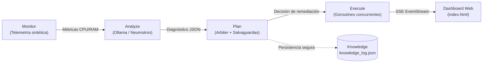

<div align="center">

# SmartOps

**Bucle autonómico MAPE-K en Go puro. Auto-repara anomalías de infraestructura en piloto automático y solo escala a humano cuando el fuego es real.**

[](https://go.dev/)
[](https://ollama.com/)
[](https://en.wikipedia.org/wiki/Autonomic_computing)
[-0F6E56)](https://pkg.go.dev/std)
[](LICENSE)

[English](README.md) · **Español**

</div>

---

SmartOps implementa un bucle autonómico completo **MAPE-K** (*Monitor, Analyze, Plan, Execute, Knowledge*) para auto-remediación de infraestructura. Genera telemetría sintética de nodos de cómputo, delega el diagnóstico a un **modelo local en Ollama** (`nemotron-3-nano:4b`) forzado por esquema JSON estructurado, aplica salvaguardas de frecuencia con un motor de reglas (**Arbiter**), ejecuta mitigaciones concurrentes y transmite todo el flujo en vivo al navegador mediante *Server-Sent Events* (SSE).

> [!IMPORTANT]
> **El modelo diagnostica y clasifica; el Arbiter decide, auto-remedia y salvaguarda.**  
> Los picos operativos rutinarios se corrigen en automático. Si las acciones consecutivas superan los límites de seguridad de frecuencia o la confianza decae, el sistema no inventa y escala de inmediato a un operador humano.

## Características

- **Cero dependencias externas.** Construido exclusivamente con la librería estándar de Go (`net/http`, `embed`, `sync`, `encoding/json`).
- **Salida JSON estructurada y forzada.** Ollama devuelve únicamente objetos validados por esquema JSON (`type`, `anomaly`, `severity`), sin divagaciones de texto libre.
- **Salvaguardas de seguridad (Arbiter).** Ventana deslizante de límite de frecuencia (máximo 2 acciones automáticas por ventana antes de escalar a humano).
- **Tablero reactivo en tiempo real.** Interfaz web limpia con Server-Sent Events (SSE) y renderizado seguro en DOM (cero frameworks, CSS nativo, prevención de XSS).
- **Modo Mock determinístico.** Permite ejecutar y probar toda la arquitectura al instante sin necesidad de GPU ni Ollama instalado.
- **Persistencia concurrente (Knowledge).** Registro auditado de decisiones en `knowledge_log.json` protegido con bloqueos de lectura/escritura (`sync.RWMutex`).

## Arquitectura



| Archivo | Rol |
|---|---|
| `main.go` | Servidor HTTP, orquestador MAPE-K, integración con Ollama y persistencia |
| `main_test.go` | Pruebas unitarias con casos de tabla para decisiones y salvaguardas del Arbiter |
| `static/index.html` | Tablero reactivo en vivo con Server-Sent Events y CSS nativo |
| `knowledge_log.json` | Base de conocimiento local y auditoría de decisiones |
| `go.mod` | Módulo Go (Go stdlib puro) |

## Inicio Rápido

**Requisitos:** Go 1.22+ y opcionalmente [Ollama](https://ollama.com/) para inferencia con LLM local.

```bash
# 1. (Opcional) Descargar el modelo en Ollama para análisis con LLM
ollama pull nemotron-3-nano:4b

# 2. Correr las pruebas unitarias
go test -v ./...

# 3. Iniciar el servidor
go run .

# 4. Abrir el tablero en el navegador
# http://localhost:8090
```

> [!TIP]
> Si no tienes Ollama instalado o quieres una demostración instantánea sin consumo de GPU, marca la casilla **"Modo mock (sin Ollama)"** en la interfaz web.

## Flujo de Demostración por Ciclos

Al iniciar una demo de 6 ciclos, el sistema inyecta una anomalía de CPU en los ciclos 3 al 5 en el nodo `web-01`:

| Ciclo | Condición observada | Diagnóstico (Analyze) | Decisión (Plan) | Ejecución (Execute) |
|---|---|---|---|---|
| **1–2** | Métricas normales (CPU 20–55%, RAM 30–60%) | `none` (Severidad 0.10) | `sin_accion` | Ninguna |
| **3** | Anomalía inyectada en `web-01` (CPU > 88%) | `cpu_spike` (Severidad 0.90) | `escalamiento_horizontal` | Goroutine concurrente (150 ms) |
| **4** | Anomalía persistente en `web-01` (CPU > 88%) | `cpu_spike` (Severidad 0.90) | `escalamiento_horizontal` | Goroutine concurrente (150 ms) |
| **5** | Tercera anomalía consecutiva | `cpu_spike` (Severidad 0.90) | `escalar_a_humano` *(Límite excedido)* | Ninguna (Alerta de escalado) |
| **6** | Retorno a métricas base | `none` (Severidad 0.10) | `sin_accion` | Ninguna |

## Selección de Modelo

El modelo predeterminado es `nemotron-3-nano:4b`, pero puedes usar cualquier modelo de Ollama compatible con formato JSON estructurado:

| Modelo | RAM / VRAM Aprox. | Salida JSON estructurado | Uso recomendado |
|---|---|---|---|
| `nemotron-3-nano:4b` *(predeterminado)* | ~3 GB | Excelente | Razonamiento operacional y clasificación |
| `qwen2.5:3b` | ~2.5 GB | Muy bueno | Alternativa ultra-ligera para laptops |
| `granite3-dense:8b` | ~6 GB | Excelente | Escenarios empresariales con GPU dedicada |
| `llama3.2:3b` | ~2.5 GB | Bueno | Inferencia rápida en CPU |

Para cambiar el modelo, ajusta la constante `modelName` en `main.go`.

## Modelo de Datos (Knowledge)

Las decisiones tomadas durante cada sesión se persisten en `knowledge_log.json` al finalizar la corrida:

```json
{
  "web-01": [
    {
      "ciclo": 3,
      "accion": "escalamiento_horizontal",
      "razon": "regla aplicada para cpu_spike"
    },
    {
      "ciclo": 5,
      "accion": "escalar_a_humano",
      "razon": "limite de frecuencia excedido"
    }
  ]
}
```

El historial se consulta directamente desde la interfaz mediante el botón **"Ver Knowledge"** o vía HTTP en `/knowledge`.

## Pruebas Automatizadas

El proyecto incluye pruebas unitarias para el motor de reglas y salvaguardas sin requerir infraestructura externa:

```bash
go test -v ./...
```

Verifica:
1. Métricas normales resultan en `sin_accion`.
2. Anomalías por pico de CPU desencadenan `escalamiento_horizontal`.
3. Más de 2 acciones dentro de la ventana de frecuencia escalan a `escalar_a_humano`.

## Roadmap

- [ ] Integración con Prometheus / OpenTelemetry como fuente de métricas reales (Monitor)
- [ ] Webhook de notificación para eventos `escalar_a_humano` (Slack, Discord, PagerDuty)
- [ ] Integración con la API de Kubernetes para escalado real de Pods (Execute)
- [ ] Base de datos SQLite embebida para analítica histórica de incidentes (Knowledge)

## Licencia

Este proyecto está disponible bajo la licencia **MIT**. Para fines educativos y de demostración técnica de computación autonómica.
