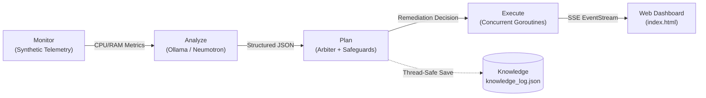

<div align="center">

# SmartOps

**Autonomous MAPE-K control loop in pure Go. Local AI auto-fixes infrastructure anomalies on autopilot and escalates to a human only when the fire is real.**

[](https://go.dev/)
[](https://ollama.com/)
[](https://en.wikipedia.org/wiki/Autonomic_computing)
[-0F6E56)](https://pkg.go.dev/std)
[](LICENSE)

**English** · [Español](README.es.md)

</div>

---

SmartOps implements a complete **MAPE-K** (*Monitor, Analyze, Plan, Execute, Knowledge*) autonomic control loop for infrastructure self-healing. It generates synthetic server telemetry, delegates anomaly evaluation to a **local Ollama LLM** (`nemotron-3-nano:4b`) constrained by a strict JSON schema, applies rate-limiting safeguards through a rules engine (**Arbiter**), triggers concurrent remediations, and streams the entire workflow live to the browser via *Server-Sent Events* (SSE).

> [!IMPORTANT]
> **The model diagnoses and classifies; the Arbiter decides, auto-remediates, and safeguards.**  
> Routine operational spikes are mitigated automatically. If consecutive actions breach frequency safety limits or confidence drops, the system stops guessing and immediately escalates to a human operator.

## Features

- **Zero external dependencies.** Built strictly with the Go standard library (`net/http`, `embed`, `sync`, `encoding/json`).
- **Enforced JSON schema output.** Ollama returns strictly structured JSON (`type`, `anomaly`, `severity`) without conversational preamble.
- **Safety safeguards (Arbiter).** Sliding window rate limiter (maximum 2 automated actions per window before escalating to human).
- **Real-time reactive dashboard.** Clean web UI with Server-Sent Events (SSE) and XSS-safe DOM rendering (zero JS frameworks, native CSS).
- **Deterministic mock mode.** Instantly test and demonstrate the entire loop without needing a GPU or an Ollama daemon.
- **Concurrent persistence (Knowledge).** Audited decision history stored in `knowledge_log.json`, thread-safe via `sync.RWMutex`.

## Architecture



| File | Role |
|---|---|
| `main.go` | HTTP server, MAPE-K orchestrator, Ollama client, and persistence |
| `main_test.go` | Table-driven unit tests for Arbiter decision rules and safeguards |
| `static/index.html` | Real-time browser board with Server-Sent Events and native CSS |
| `knowledge_log.json` | Local knowledge base and decision audit log |
| `go.mod` | Go module declaration (pure Go stdlib) |

## Quick Start

**Requirements:** Go 1.22+ and optionally [Ollama](https://ollama.com/) for local LLM inference.

```bash
# 1. (Optional) Pull the model for real LLM analysis
ollama pull nemotron-3-nano:4b

# 2. Run unit tests
go test -v ./...

# 3. Start the server
go run .

# 4. Open the web dashboard
# http://localhost:8090
```

> [!TIP]
> If you don't have Ollama installed or want an instant run without GPU overhead, check the **"Modo mock (sin Ollama)"** box in the web interface.

## Demonstration Cycle Flow

When starting a 6-cycle demo run, the monitor injects a CPU spike in cycles 3 through 5 on node `web-01`:

| Cycle | Observed Condition | Diagnosis (Analyze) | Decision (Plan) | Execution (Execute) |
|---|---|---|---|---|
| **1–2** | Normal baseline (CPU 20–55%, RAM 30–60%) | `none` (Severity 0.10) | `sin_accion` | None |
| **3** | Injected CPU anomaly on `web-01` (> 88%) | `cpu_spike` (Severity 0.90) | `escalamiento_horizontal` | Concurrent Goroutine (150 ms) |
| **4** | Persistent CPU anomaly on `web-01` (> 88%) | `cpu_spike` (Severity 0.90) | `escalamiento_horizontal` | Concurrent Goroutine (150 ms) |
| **5** | Third consecutive anomaly | `cpu_spike` (Severity 0.90) | `escalar_a_humano` *(Rate limit hit)* | None (Escalate to human) |
| **6** | Return to baseline metrics | `none` (Severity 0.10) | `sin_accion` | None |

## Choosing a Model

The default model is `nemotron-3-nano:4b`, but any Ollama model with structured JSON schema support can be used:

| Model | Approx. RAM / VRAM | JSON Schema Support | Recommended For |
|---|---|---|---|
| `nemotron-3-nano:4b` *(default)* | ~3 GB | Excellent | Operational reasoning & classification |
| `qwen2.5:3b` | ~2.5 GB | Very good | Ultra-lightweight laptop inference |
| `granite3-dense:8b` | ~6 GB | Excellent | Enterprise workloads with dedicated GPU |
| `llama3.2:3b` | ~2.5 GB | Good | Fast CPU-only inference |

To switch models, change the `modelName` constant in `main.go`.

## Data Model (Knowledge)

Decisions made during each run are merged and persisted into `knowledge_log.json` when the stream finishes:

```json
{
  "web-01": [
    {
      "ciclo": 3,
      "accion": "escalamiento_horizontal",
      "razon": "regla aplicada para cpu_spike"
    },
    {
      "ciclo": 5,
      "accion": "escalar_a_humano",
      "razon": "limite de frecuencia excedido"
    }
  ]
}
```

The history can be inspected in the web UI by clicking **"Ver Knowledge"** or programmatically via `GET /knowledge`.

## Automated Tests

Unit tests verify the decision logic and safety limits without external services:

```bash
go test -v ./...
```

Validates:
1. Baseline readings yield `sin_accion`.
2. CPU spike anomaly triggers `escalamiento_horizontal`.
3. Exceeding the rate limit triggers `escalar_a_humano`.

## Roadmap

- [ ] Prometheus / OpenTelemetry receiver as live telemetry source (Monitor)
- [ ] Incident notification webhooks for `escalar_a_humano` (Slack, Discord, PagerDuty)
- [ ] Kubernetes API integration for real Pod replica adjustments (Execute)
- [ ] Embedded SQLite engine for time-series trend analysis (Knowledge)

## License

This project is licensed under the **MIT License**. For educational and demonstration purposes in autonomic computing.
